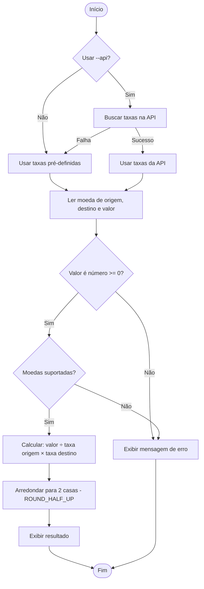

# Documentação Técnica: Conversor de Moedas

## 1. Descrição da funcionalidade
O conversor recebe uma moeda de origem, uma moeda de destino e um valor, e devolve o valor equivalente com duas casas decimais.

- **Moedas suportadas:** USD, EUR e BRL.
- **Método de cálculo:** todas as taxas são expressas em relação ao USD (moeda-base). Para converter A → B:

  ```
  resultado = valor ÷ taxa[A] × taxa[B]
  ```
- **Precisão:** usa o tipo `Decimal` (e não `float`) para evitar erros de ponto flutuante. O arredondamento é `ROUND_HALF_UP`, o arredondamento comercial usual.
- **Fonte das taxas:** tabela pré-definida (padrão) ou API externa (opcional, `--api`), com fallback automático para a tabela em caso de falha.

## 2. Diagrama de fluxo



## 3. Interfaces necessárias

### 3.1 Interface do usuário (linha de comando)
```
=== Conversor de Moedas ===
Moedas disponíveis: USD, EUR, BRL
Moeda de origem: usd
Moeda de destino: brl
Valor a converter: 10,5
10.50 USD = 52.50 BRL
```
- Códigos de moeda não diferenciam maiúsculas/minúsculas e ignoram espaços.
- O valor aceita ponto ou vírgula como separador decimal.
- Erros são exibidos como `Erro: <mensagem>` e o programa termina sem exceção não tratada.

### 3.2 Interface programática (módulo `conversor.py`)

| Função | Descrição |
|--------|-----------|
| `converter(valor, origem, destino, taxas=None) -> Decimal` | Núcleo da conversão. Lança `ErroConversao` (ou subclasse) em caso de entrada inválida. |
| `interpretar_valor(texto) -> Decimal` | Converte texto digitado (`"10,5"`) em `Decimal`. |
| `buscar_taxas_api(url, timeout) -> dict` | Consulta a API e retorna `{moeda: Decimal}`. |
| `obter_taxas(usar_api) -> (dict, fonte)` | Escolhe API ou tabela padrão, com fallback. |
| `executar_cli(entrada, saida, taxas)` | Interface de texto; `entrada`/`saida` são injetáveis, o que permite testá-la. |

### 3.3 Exceções

```
ValueError
└── ErroConversao
    ├── MoedaInvalidaError
    ├── ValorInvalidoError
    ├── TaxaInvalidaError
    └── ErroApiTaxas
```

## 4. Banco de dados / armazenamento
**Não há banco de dados nem persistência em disco.** As taxas pré-definidas ficam em memória, na constante `TAXAS_PADRAO`, e as taxas da API são mantidas em memória apenas durante a execução. Nenhum histórico de conversões é salvo.

## 5. APIs e serviços externos
- **Serviço (opcional):** ExchangeRate-API, endpoint aberto `https://open.er-api.com/v6/latest/USD` (sem chave de acesso).
- **Uso:** somente quando o programa é iniciado com `--api`.
- **Formato esperado da resposta:**
  ```json
  {"result": "success", "rates": {"USD": 1, "EUR": 0.9, "BRL": 5.5}}
  ```
- **Tratamento de falhas:** timeout de 5 s; qualquer erro de rede, JSON inválido, `result` diferente de `success` ou ausência de alguma das moedas gera `ErroApiTaxas`, e o sistema usa `TAXAS_PADRAO`.
- **Testes:** a API é simulada com `unittest.mock`, então os testes não dependem de internet.
- **Observação:** confira os termos de uso e os limites do serviço antes de usá-lo além do exercício.

## 6. Como executar

```bash
python conversor.py          # taxas pré-definidas
python conversor.py --api    # tenta taxas atualizadas
python -m unittest -v        # executa os testes
```
Requisitos: Python 3.8+ e apenas a biblioteca padrão (sem dependências externas).

## 7. Decisões de projeto
| Decisão | Motivo |
|---------|--------|
| `Decimal` em vez de `float` | Evita erros como `1.005 → 1.00`; exigido pela regra de arredondamento. |
| Taxas relativas ao USD | Uma única tabela cobre qualquer par de moedas. |
| `entrada`/`saida` injetáveis na CLI | Permite testar a interface sem digitar nada. |
| Fallback para taxas padrão | O programa continua funcionando sem internet. |
